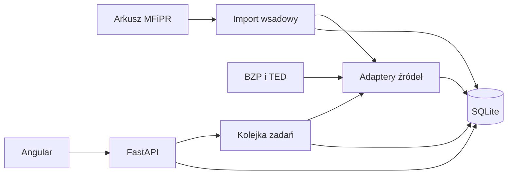

# Projekt Kompas · Risk Miner

Pilotaż MFiPR dla inwestycji wodociągowo-kanalizacyjnych. Risk Miner łączy zweryfikowane materiały z wcześniejszych inwestycji, pozwala ekspertowi poprawić ustalenia i wykorzystuje przypadki historyczne podczas oceny planowanego projektu.

## Uruchomienie

Uruchom `./start.sh` z zainstalowanym Docker Compose i otwórz **http://localhost:4200**. Backend udostępnia dokumentację API pod **http://localhost:8000/docs**. Compose zapisuje bazę w `data/`. Przy pierwszym uruchomieniu bez bazy rzeczywistej aplikacja otworzy osobną bazę demonstracyjną. Dokumenty, importy i decyzje pozostają w niej po restarcie.

Bez Dockera uruchom backend i frontend w dwóch terminalach z katalogu repozytorium.

```bash
uv run --project backend --locked uvicorn --app-dir backend main:app
```

```bash
cd frontend
npm ci
npm start
```

1. Wybierz rolę **Operator** i w widoku **Import i źródła** wgraj [arkusz organizatora](docs/Risk_Miner_dane_projekty.xlsx). Import zapisuje poprawne wiersze i pobiera ogłoszenia BZP oraz TED. Raport zawiera błędy poszczególnych zapytań i powiązania oczekujące na ocenę.
2. Wybierz rolę **Ekspert**. Weryfikacja ekspercka pokazuje podstawę dopasowania, dokument źródłowy i historię decyzji. Widok **Wszystkie rekordy** umożliwia też edycję danych wejściowych. W zakładce dokumentów karty projektu możesz wgrać aneks, umowę lub protokół i sprawdzić wynik ekstrakcji.
3. Wybierz rolę **Analityk**. Otwórz **Nowa inwestycja**, zapisz opis albo wgraj dokument, a następnie uruchom analizę. Otwórz podobny przypadek, sprawdź dowody i pobierz wynik w JSON lub CSV. Do poprzednich analiz wrócisz z karty projektu.

Przykładowy opis do sprawdzenia lokalnej analizy to „Rozbudowa sieci wodociągowej o 2 km i 60 przyłączy. Planowane roboty potrwają 12 miesięcy. Brakuje zgody właściciela na dostęp do działki.”

## Dane rzeczywiste i odczyt źródeł

Arkusz MFiPR i metodyka sektorowa zasilają historyczną bazę wsadowo. Skrypt `backend/scrape.py` materializuje rekordy w SQLite, pobiera związane z nimi ogłoszenia i zachowuje oryginalne odpowiedzi. W aplikacji te same adaptery odpytują BZP i TED podczas importu lub odświeżenia wybranego projektu. Analiza planu czyta zapisaną bazę. Opisy i dokumenty planowanych inwestycji nie są przesyłane do rejestrów zamówień.

```bash
uv run --project backend --locked python backend/scrape.py --input docs/Risk_Miner_dane_projekty.xlsx
```

Na potrzeby pilotażu można wskazać kopię BZP organizatora przez `RISK_MINER_BZP_URL`. Po przygotowaniu bazy ustaw `RISK_MINER_TOKENS` w `backend/.env` i uruchom `docker compose --env-file backend/.env up --build`. W przeglądarce wybierz **Token dostępu** i wklej skonfigurowany token. Dostęp do prywatnego projektu jest przypisany do tożsamości. Podczas lokalnej prezentacji jedna tożsamość może mieć trzy role. [Przykład konfiguracji](backend/.env.example)

## Architektura i metoda



Projekt wiąże się z postępowaniami, a postępowanie z częściami, ogłoszeniami i umowami. Zmiany, kwoty i daty zachowują właściwy zakres. Dowód prowadzi do pola, wiersza, strony lub akapitu we wskazanej wersji źródła. Decyzja zapisuje autora, powód, czas oraz stan przed i po zmianie.

Dopasowanie preferuje zgodny numer publikacji i sprawdza nazwę zamawiającego lub identyfikator podmiotu oraz przedmiot. Ogłoszenia BZP dotyczące tego samego postępowania łączy OCID. Kandydaci bez wystarczającego potwierdzenia trafiają do kolejki eksperta. Porównanie analizuje cechy strukturalne i tekst zakończonych przypadków. Przedział odchyleń wymaga co najmniej trzech porównywalnych przypadków. Wynik pokazuje liczebność próby, braki i poziom pewności.

Ekstrakcja podstawowa działa lokalnie z regułami i nie potrzebuje klucza. Opcjonalny adres zgodny z Chat Completions, nazwa modelu i klucz są ustawiane w środowisku. Po włączeniu modelu wybrane fragmenty dokumentu trafiają do wskazanego serwera. Region przetwarzania i licencja zależą od wybranego modelu i wdrożenia. [Konfiguracja i licencje bibliotek](docs/implementation/backend.md) · [Specyfikacja OpenAPI](docs/openapi.yaml) · [Oficjalne API BZP](https://ezamowienia.gov.pl/pl/integracja/) · [TED Search API](https://docs.ted.europa.eu/api/latest/search.html)

## Testy
Materiały odbiorowe są w [raporcie testu](docs/contest/raport-testu.md). [Prezentacja PDF](docs/contest/prezentacja.pdf) · [Nagranie demonstracji](docs/contest/demo.mp4)

```bash
PYTHONPATH=backend uv run --project backend --locked python -m unittest discover -s backend/tests -v
uv run --project backend --locked ruff check backend
cd frontend && npm ci && npm run build
```

Przy uruchomieniu poza Dockerem obsługa starszego formatu DOC wymaga zainstalowanego programu `antiword` (GPL-2.0-or-later). Obsługę XLS zapewnia `xlrd` (BSD-3-Clause). [Instrukcja uruchomienia backendu](docs/implementation/backend.md)
